

# R1tec Launcher

**A home screen for Android TV with prayer times, weather and today's football matches.**
**واجهة رئيسية لأجهزة Android TV مع أوقات الصلاة والطقس ومباريات اليوم.**

[English](#english) · [العربية](#العربية)

### [⬇ Download R1tec-Launcher.apk / تحميل](https://github.com/r1tec-store/R1tec-Launcher/releases/latest/download/R1tec-Launcher.apk)

Permanent link — always the latest version / رابط دائم — دائماً آخر إصدار:  
`https://github.com/r1tec-store/R1tec-Launcher/releases/latest/download/R1tec-Launcher.apk`

Version number, changes and checksum: [latest release](https://github.com/r1tec-store/R1tec-Launcher/releases/latest) · رقم الإصدار والتغييرات: [آخر إصدار](https://github.com/r1tec-store/R1tec-Launcher/releases/latest)

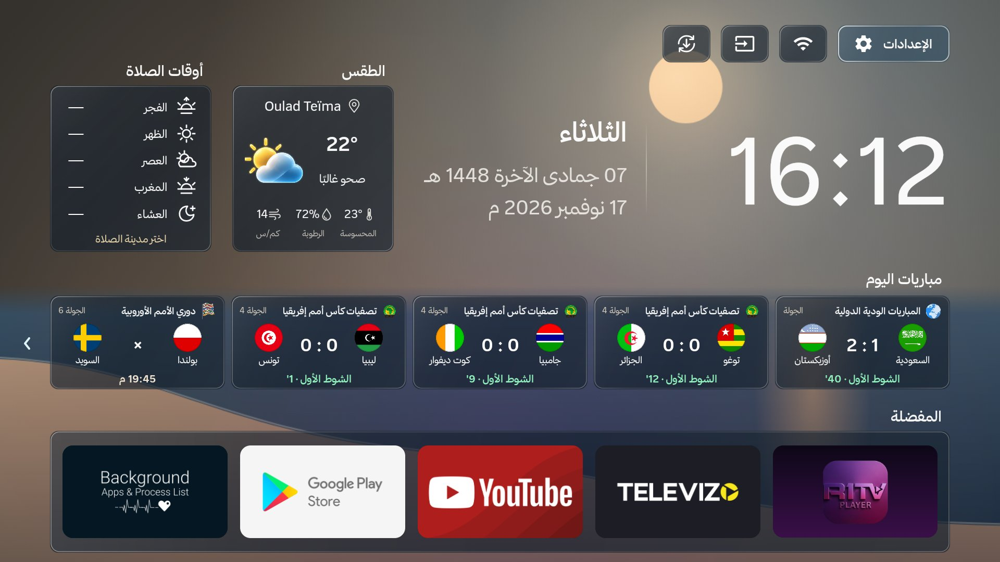

---

## English

R1tec Launcher replaces the default Android TV home screen with a clean, remote-friendly interface. Everything you need is on one screen: the time and the Hijri and Gregorian dates, prayer times, the weather, today's matches for your teams, and your apps.

###  Downloader code / كود داونلودر: **6185367**

In the *Downloader* app on your TV, type **6185367** to install the latest R1tec Launcher.
في تطبيق *Downloader* على التلفاز، اكتب الكود **6185367** لتثبيت آخر إصدار من R1tec Launcher.

### Download and install

1. Download [`R1tec-Launcher.apk`](https://github.com/r1tec-store/R1tec-Launcher/releases/latest/download/R1tec-Launcher.apk) (always the latest version).
2. Install it on the TV, for example with a file manager, *Downloader*, or `adb install R1tec-Launcher.apk`.
3. Open R1tec Launcher. On first launch it asks to become the default Home app; confirm once.
   Installing from a PC? `install-on-tv.bat <TV_IP>` installs the app and sets it as Home automatically.

**Requirements:** Android TV / Google TV, Android 8.0 (API 26) or newer.

### Features

#### Home screen
- Large clock with the weekday and both the **Hijri and Gregorian** dates.
- **Animated living sky** (sun, moon, stars and drifting clouds that follow the time of day), or a choice of photo wallpapers, including your own image from USB or a file.
- **Favorites row** for your most-used apps, plus a full **Applications** grid.
- **Move apps between Favorites and Applications:** hold OK on an app → *Move app*, then **Up/Down** carries it between the two rows and the arrows place it; OK saves.
- Focused apps get a **gold ring** and zoom in, in both rows.
- Top bar with quick actions: settings, Wi-Fi, input source and app update.
- Fully navigable with the TV remote, with **Arabic (RTL) and English** interfaces.

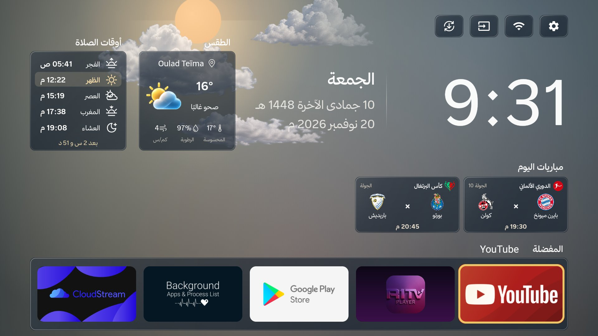

#### Today's matches widget
- Live list of today's football matches from **365Scores**: score, minute, half, round and competition.
- Follow **teams**, from clubs in 40+ leagues to **all national teams** (216 teams, including Morocco, Algeria, Saudi Arabia, Egypt, France and Brazil).
- Follow **competitions**: Premier League, LaLiga, Serie A, Bundesliga, Ligue 1, Champions League, Botola Pro, AFCON, World Cup, qualifiers and friendlies.
- Filter by *selected teams only* and/or *selected competitions only*. Out of the box it ships with 67 popular teams selected and the "selected teams only" filter on.
- **Match details:** date and time, round, stadium and referee.
- **Match alerts** on the TV: goals, score corrections and VAR, kick-off and half-time, cards, penalties and substitutions, with a choice of alert sound and volume and a *favorites only* option.

| Match details | Teams by competition (National Teams) |
|---|---|
| 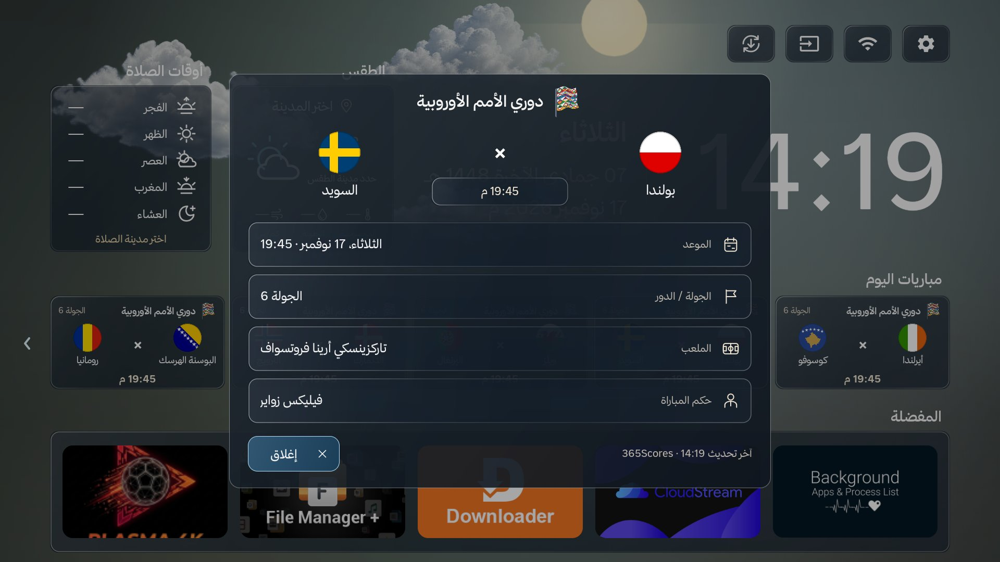 | 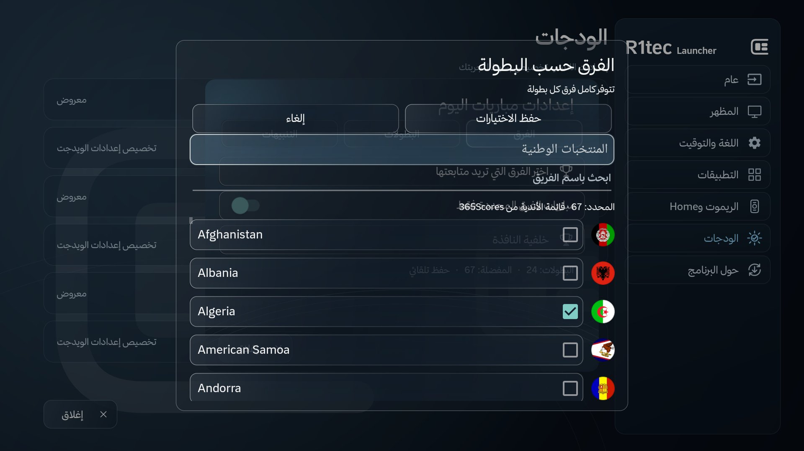 |

| Teams | Competitions | Alerts |
|---|---|---|
| 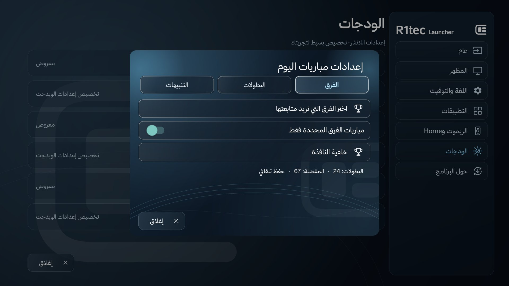 | 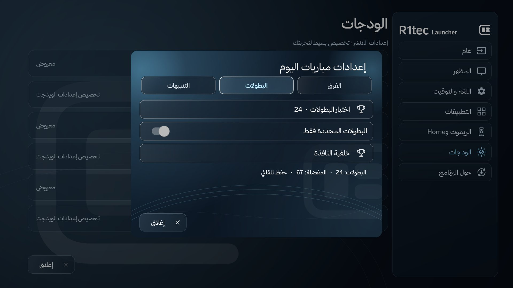 | 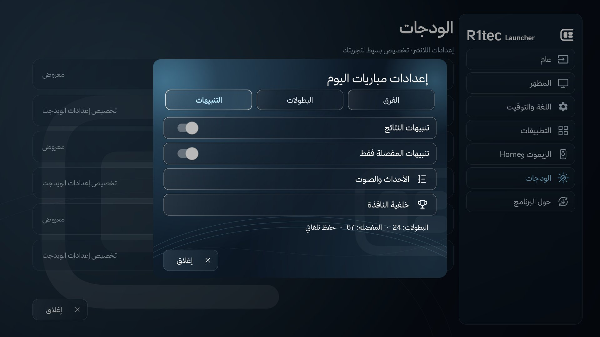 |

#### Prayer times
- Five daily prayers plus sunrise, with the next prayer highlighted.
- Calculation methods per country, including Morocco, Saudi Arabia, Algeria, Tunisia, Egypt, Jordan, Kuwait, Palestine and more.
- **Adhan** with several reciters or your own audio file, adjustable volume, and reminders before each prayer.
- City search, or location by GPS or network. Selecting the widget before a city is set opens the city picker.

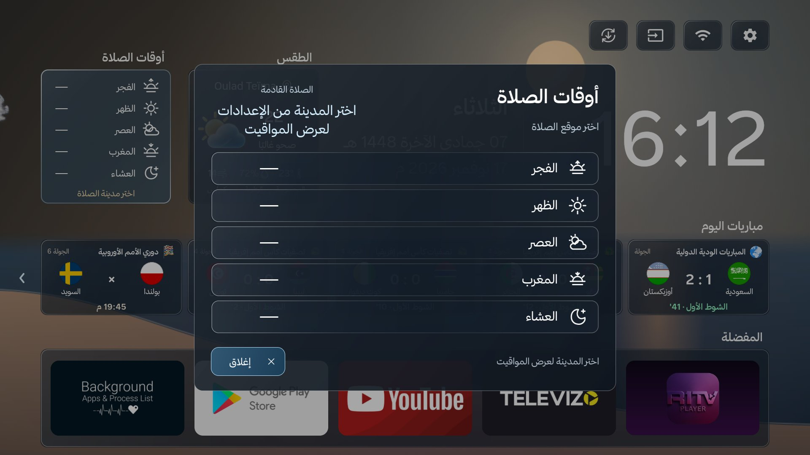

#### Weather
- Current conditions, temperature, feels-like, humidity and wind (Open-Meteo).
- Automatic location or city search. Selecting the widget before a city is set opens the city picker.

#### Updates
- **About → Check for updates** reads the latest release on this GitHub repository, shows its notes, then downloads and installs it.
- The home screen also checks in the background (at most once an hour) and announces a new version as soon as it is published.
- Downloads are HTTPS-only from GitHub, and the APK must be R1tec Launcher, newer than the installed version and **signed with the same key** before it is installed. Android asks once to allow R1tec to install updates.

#### Settings
- **General:** default Home screen, home setup guide, quick settings, screensaver, import/export of settings.
- **Appearance:** wallpaper (animated sky or photos), container opacity, corner radius, reset.
- **Language and time:** Arabic or English, 12/24-hour clock.
- **Applications:** organize favorites, rename, hide or restore apps, uninstall.
- **Remote and Home:** set R1tec as the default Home app. (The accessibility-based Home-button shortcut is turned off so Google Play Protect no longer blocks installation.)
- **Widgets:** one-click On/Off switch for each widget (weather, prayer, matches) independently, plus each widget's own settings.
- **Screensaver** (Android "Daydream") with the animated sky.
- **Backup:** export and import all launcher and widget settings.

| Quick menu | General | Widgets |
|---|---|---|
| 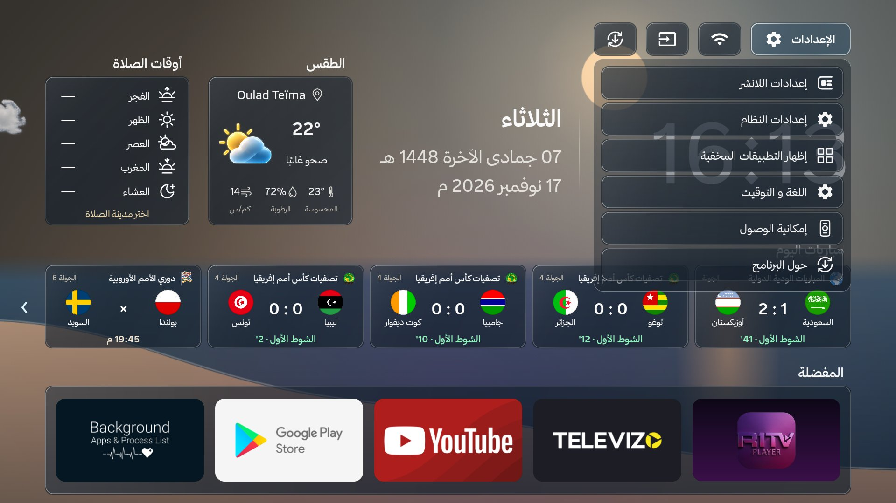 | 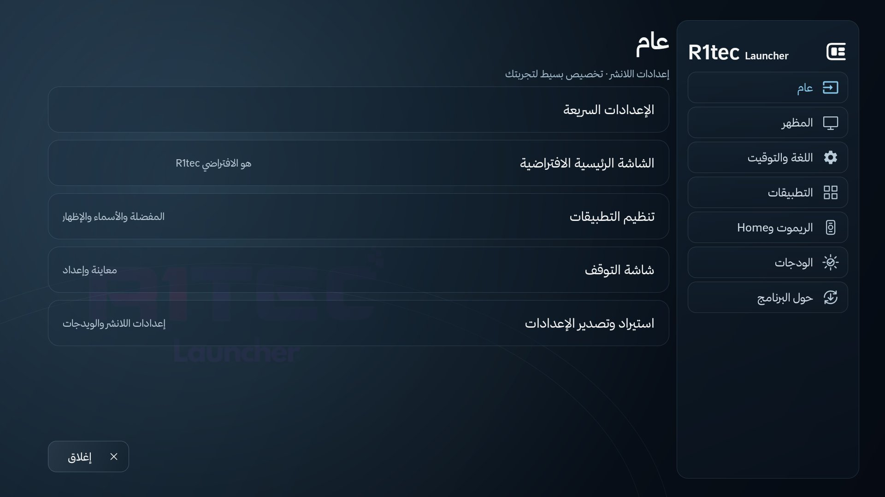 | 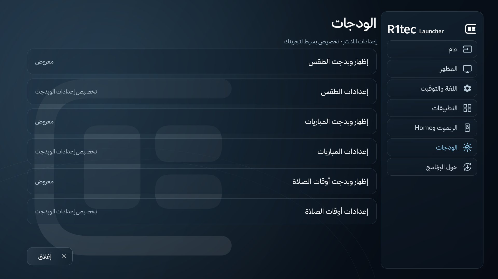 |

| Appearance | Applications | About |
|---|---|---|
| 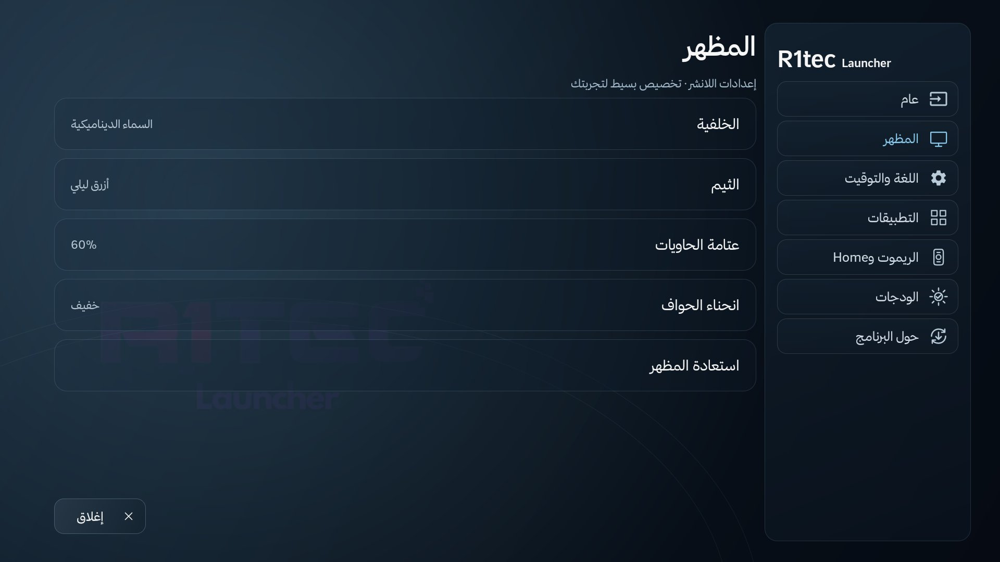 | 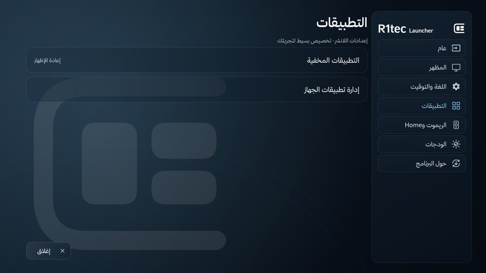 | 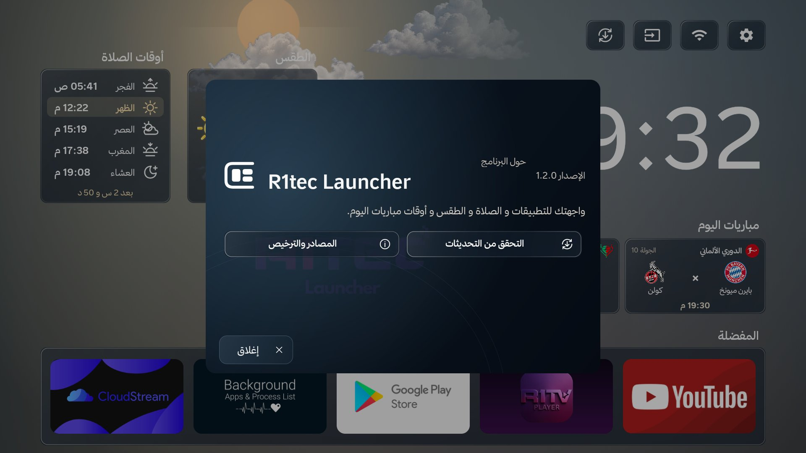 |

### Permissions

| Permission | Why |
|---|---|
| Internet, network and Wi-Fi state | Matches, weather and prayer data; the Wi-Fi menu |
| Location (coarse and fine) | Automatic city for prayer times and weather (optional) |
| Notifications and foreground service (media playback) | Match alerts and adhan playback |
| Exact alarms, boot completed and wake lock | Prayer reminders that fire on time, even after a restart |
| Request delete packages | Uninstall apps from the launcher |
| Request install packages | Install updates downloaded from GitHub (you confirm each install) |

### Data sources
- Matches: [365Scores](https://www.365scores.com) (unofficial web API, see [docs/365scores-api.md](docs/365scores-api.md))
- Weather: [Open-Meteo](https://open-meteo.com)
- Prayer calendar: [Aladhan](https://aladhan.com) and on-device calculation
- Wallpapers: Unsplash (NEOM, Hala AlGhanim)

R1tec Launcher is not affiliated with 365Scores, Open-Meteo or Aladhan.

---

## العربية

يستبدل R1tec Launcher الواجهة الرئيسية الافتراضية في Android TV بواجهة أنيقة سهلة الاستعمال بالريموت. كل ما تحتاجه في شاشة واحدة: الساعة والتاريخ الهجري والميلادي، وأوقات الصلاة، والطقس، ومباريات اليوم لفرقك، وتطبيقاتك.

### التحميل والتثبيت

1. حمّل الملف [`R1tec-Launcher.apk`](https://github.com/r1tec-store/R1tec-Launcher/releases/latest/download/R1tec-Launcher.apk) (دائماً آخر إصدار).
2. ثبّته على التلفاز، مثلاً عبر مدير الملفات أو تطبيق *Downloader*، أو بالأمر `adb install R1tec-Launcher.apk`.
3. افتح R1tec Launcher. عند أول تشغيل يطلب أن يصبح الشاشة الرئيسية الافتراضية، فوافق مرة واحدة.
   للتثبيت من الحاسوب: الأمر `install-on-tv.bat <IP_التلفاز>` يثبّت التطبيق ويجعله الشاشة الرئيسية تلقائياً.

**المتطلبات:** Android TV أو Google TV، بنظام Android 8.0 (API 26) أو أحدث.

### المميزات

#### الشاشة الرئيسية
- ساعة كبيرة مع اليوم والتاريخ **الهجري والميلادي**.
- **سماء حيّة متحركة** (شمس وقمر ونجوم وسحب تتغير حسب الوقت)، أو صور خلفية جاهزة، أو صورتك الخاصة من USB أو من ملف.
- **صف المفضلة** لأكثر التطبيقات استعمالاً، وشبكة **كل التطبيقات**.
- **نقل التطبيقات بين المفضلة والتطبيقات:** اضغط مطولاً على OK فوق تطبيق ← *نقل التطبيق*، ثم **أعلى/أسفل** للانتقال بين الصفين والأسهم لتحديد المكان، وOK للحفظ.
- التطبيق المحدد يظهر بـ**إطار ذهبي** ويتكبّر، في الصفين معاً.
- شريط علوي للوصول السريع: الإعدادات، والواي فاي، ومصدر الإدخال، وتحديث التطبيق.
- تنقل كامل بالريموت، وواجهة **بالعربية (من اليمين لليسار) وبالإنجليزية**.

#### ويدجت مباريات اليوم
- قائمة حيّة بمباريات اليوم من **365Scores**: النتيجة، والدقيقة، والشوط، والجولة، والبطولة.
- متابعة **الفرق**: أندية من أكثر من 40 دوري، و**كل المنتخبات الوطنية** (216 منتخباً، منها المغرب والجزائر والسعودية ومصر وفرنسا والبرازيل).
- متابعة **البطولات**: الدوري الإنجليزي والإسباني والإيطالي والألماني والفرنسي، ودوري الأبطال، والبطولة الاحترافية المغربية، وكأس أمم إفريقيا، وكأس العالم، والتصفيات، والمباريات الودية.
- فلترة بـ*الفرق المحددة فقط* و/أو *البطولات المحددة فقط*. يأتي افتراضياً مع 67 فريقاً مختاراً، وفلتر "الفرق المحددة فقط" مفعّل.
- **تفاصيل المباراة:** الموعد، والجولة، والملعب، والحكم.
- **تنبيهات المباريات** على التلفاز: الأهداف، وتصحيح النتيجة والـVAR، وبداية المباراة ونهاية الأشواط، والبطاقات، وضربات الجزاء، والتبديلات، مع اختيار صوت التنبيه ومستواه، وخيار *المفضلة فقط*.

#### أوقات الصلاة
- الصلوات الخمس والشروق، مع إبراز الصلاة القادمة.
- طرق حساب حسب البلد، منها المغرب والسعودية والجزائر وتونس ومصر والأردن والكويت وفلسطين وغيرها.
- **الأذان** بعدة أصوات أو بملف صوتي خاص، مع التحكم في مستوى الصوت، وتذكير قبل كل صلاة.
- البحث عن المدينة، أو تحديد الموقع عبر GPS أو الشبكة. الضغط على الويدجت قبل تحديد المدينة يفتح إعداد المدينة مباشرة.

#### الطقس
- الحالة الحالية، ودرجة الحرارة، والإحساس الحراري، والرطوبة، والرياح (من Open-Meteo).
- تحديد الموقع تلقائياً أو بالبحث عن المدينة. الضغط على الويدجت قبل تحديد المدينة يفتح إعداد المدينة مباشرة.

#### التحديثات
- **حول البرنامج ← التحقق من التحديثات** يقرأ آخر إصدار في هذا المستودع على GitHub، ويعرض ملاحظاته، ثم ينزّله ويثبّته.
- تتحقق الشاشة الرئيسية أيضاً في الخلفية (مرة في الساعة على الأكثر)، وتنبّهك إلى الإصدار الجديد فور نشره.
- التنزيل عبر HTTPS من GitHub فقط، ولا يُثبَّت الملف إلا إذا كان R1tec Launcher، وأحدث من الإصدار المثبت، و**موقّعاً بنفس المفتاح**. يطلب Android مرة واحدة السماح لـ R1tec بتثبيت التحديثات.

#### الإعدادات
- **عام:** الشاشة الرئيسية الافتراضية، ودليل الإعداد، والإعدادات السريعة، وشاشة التوقف، واستيراد وتصدير الإعدادات.
- **المظهر:** الخلفية (سماء متحركة أو صور)، وشفافية الحاويات، وانحناء الزوايا، وإعادة الضبط.
- **اللغة والتوقيت:** العربية أو الإنجليزية، ونظام 12 أو 24 ساعة.
- **التطبيقات:** ترتيب المفضلة، وإعادة التسمية، وإخفاء التطبيقات أو استرجاعها، والحذف.
- **الريموت وHome:** جعل R1tec الشاشة الرئيسية الافتراضية. (اختصار زر Home عبر إمكانية الوصول معطّل حتى لا يمنع Google Play Protect التثبيت.)
- **الويدجات:** مفتاح تفعيل/تعطيل بضغطة واحدة لكل ويدجت على حدة (الطقس، الصلاة، المباريات)، ولكل منها إعداداته.
- **شاشة التوقف** (Daydream) بالسماء المتحركة.
- **النسخ الاحتياطي:** تصدير واستيراد كل إعدادات اللانشر والويدجات.

### الأذونات

| الإذن | السبب |
|---|---|
| الإنترنت وحالة الشبكة والواي فاي | بيانات المباريات والطقس والصلاة، وقائمة الواي فاي |
| الموقع | تحديد المدينة تلقائياً للصلاة والطقس (اختياري) |
| الإشعارات والخدمة الأمامية (تشغيل الوسائط) | تنبيهات المباريات وتشغيل الأذان |
| المنبهات الدقيقة، والتشغيل عند الإقلاع، ومنع السكون | تذكير الصلاة في وقته حتى بعد إعادة التشغيل |
| طلب حذف التطبيقات | حذف التطبيقات من داخل اللانشر |
| طلب تثبيت التطبيقات | تثبيت التحديثات المنزّلة من GitHub (بعد تأكيدك لكل تثبيت) |

### مصادر البيانات
- المباريات: [365Scores](https://www.365scores.com) (واجهة ويب غير رسمية، انظر [docs/365scores-api.md](docs/365scores-api.md))
- الطقس: [Open-Meteo](https://open-meteo.com)
- أوقات الصلاة: [Aladhan](https://aladhan.com) والحساب على الجهاز
- الخلفيات: Unsplash (NEOM، هلا الغانم)

لا يرتبط R1tec Launcher بأي من 365Scores أو Open-Meteo أو Aladhan.

